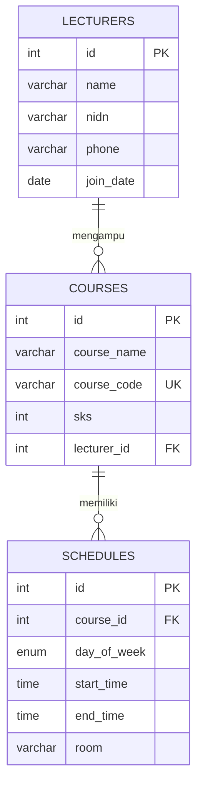
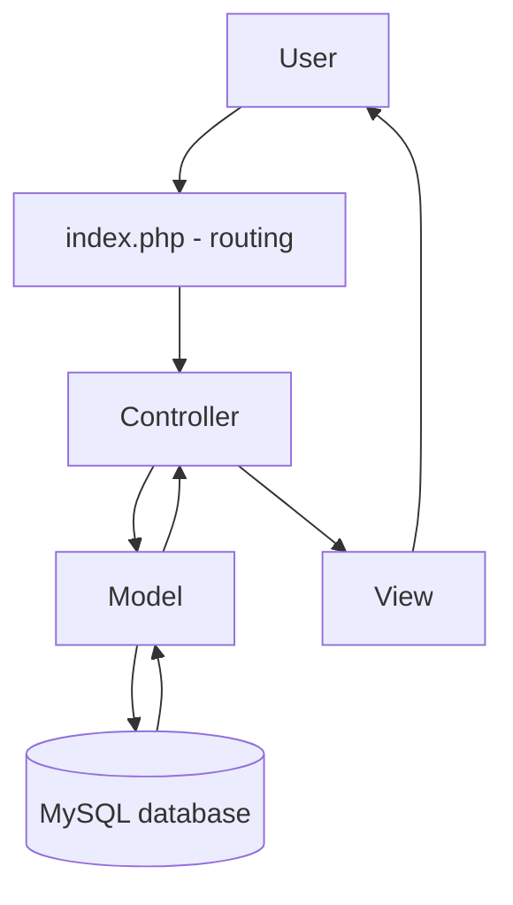

# Manajemen Akademik - TP8 MVC

Aplikasi web sederhana untuk mengelola data dosen, mata kuliah, dan jadwal perkuliahan. Project ini dibuat menggunakan PHP Native dengan pendekatan Object-Oriented Programming (OOP) dan pola arsitektur Model-View-Controller (MVC), serta MySQL sebagai basis data.

> **Informasi praktikum**  
> Mata kuliah: Desain dan Pemrograman Berbasis Objek (DPBO)  
> Modul: 9 - Model-View-Controller (MVC)  
> Nama: `[Isi nama]`  
> NIM: `[Isi NIM]`  
> Kelas: `[Isi kelas]`

## 1. Desain Program

### 1.1 Deskripsi aplikasi

Manajemen Akademik menyediakan fitur untuk mengelola tiga jenis data:

1. **Dosen (`lecturers`)**: menyimpan nama, NIDN, nomor telepon, dan tanggal bergabung dosen.
2. **Mata kuliah (`courses`)**: menyimpan nama mata kuliah, kode mata kuliah, jumlah SKS, dan dosen pengampu.
3. **Jadwal (`schedules`)**: menyimpan mata kuliah, hari, jam mulai, jam selesai, dan ruangan perkuliahan.

Aplikasi menyediakan operasi CRUD (Create, Read, Update, Delete) pada ketiga entitas tersebut.

### 1.2 Teknologi yang digunakan

- PHP Native
- Object-Oriented Programming (OOP)
- Model-View-Controller (MVC)
- MySQL / MariaDB
- MySQLi dan Prepared Statements untuk query berparameter
- Bootstrap untuk antarmuka
- XAMPP sebagai lingkungan server lokal

### 1.3 Struktur repository

Susunan pengumpulan mengikuti ketentuan modul: folder project, folder dokumentasi, file SQL, dan README.

```text
TP8DPBO2425C..\
├── Project/                     # Source code aplikasi MVC
│   ├── assets/
│   │   ├── css/
│   │   └── js/
│   ├── controllers/
│   │   ├── LecturerController.php
│   │   ├── CourseController.php
│   │   └── CourseScheduleController.php
│   ├── models/
│   │   ├── Database.php
│   │   ├── Lecturer.php
│   │   ├── Course.php
│   │   └── CourseSchedule.php
│   ├── views/
│   │   ├── lecturers/
│   │   │   ├── index.php
│   │   │   ├── create.php
│   │   │   └── edit.php
│   │   ├── courses/
│   │   │   ├── index.php
│   │   │   ├── create.php
│   │   │   └── edit.php
│   │   ├── schedules/
│   │   │   ├── index.php
│   │   │   ├── create.php
│   │   │   └── edit.php
│   │   └── layouts/
│   │       ├── header.php
│   │       └── footer.php
│   └── index.php                # Entry point dan routing aplikasi
├── Dokumentasi/                # Screenshot dan screen recording
├── tp_mvc25.sql                 # Struktur database, relasi, dan data awal
└── README.md
```

> Sesuaikan nama folder repository dengan ketentuan kelas. Pada saat menyiapkan folder `Project`, salin isi project lokal `TP8` (folder `assets`, `controllers`, `models`, `views`, dan `index.php`) ke dalamnya. Letakkan file SQL final di root repository sesuai struktur di atas. Folder cadangan `backup_awal` tidak diperlukan untuk menjalankan aplikasi dan boleh tidak disertakan dalam folder `Project`.

### 1.4 Struktur database dan relasi

Database yang digunakan bernama **`tp_mvc25`** dan terdiri dari tiga tabel.

| Tabel | Kolom utama | Fungsi |
|---|---|---|
| `lecturers` | `id`, `name`, `nidn`, `phone`, `join_date` | Menyimpan data dosen. |
| `courses` | `id`, `course_name`, `course_code`, `sks`, `lecturer_id` | Menyimpan mata kuliah dan dosen pengampu. |
| `schedules` | `id`, `course_id`, `day_of_week`, `start_time`, `end_time`, `room` | Menyimpan jadwal perkuliahan. |

Relasi antar tabel:

- Satu dosen dapat dikaitkan dengan beberapa mata kuliah (one-to-many).
- Satu mata kuliah dapat memiliki beberapa jadwal (one-to-many).
- `courses.lecturer_id` merupakan foreign key yang mengacu ke `lecturers.id`.
- `schedules.course_id` merupakan foreign key yang mengacu ke `courses.id`.



### 1.5 Pembagian komponen MVC

**Model**

Model bertanggung jawab mengelola data dan berinteraksi dengan database.

- `Database.php`: membuat dan menyediakan koneksi MySQL.
- `Lecturer.php`: operasi data dosen pada tabel `lecturers`.
- `Course.php`: operasi data mata kuliah pada tabel `courses`.
- `CourseSchedule.php`: operasi data jadwal pada tabel `schedules`.

**View**

View bertanggung jawab menampilkan antarmuka kepada pengguna.

- `views/lecturers/`: halaman daftar, tambah, dan edit dosen.
- `views/courses/`: halaman daftar, tambah, dan edit mata kuliah.
- `views/schedules/`: halaman daftar, tambah, dan edit jadwal.
- `views/layouts/`: komponen header dan footer yang digunakan bersama.

**Controller**

Controller menerima request, memanggil Model untuk mengelola data, melakukan validasi, dan menentukan View yang ditampilkan.

- `LecturerController.php`: mengatur proses dosen.
- `CourseController.php`: mengatur proses mata kuliah.
- `CourseScheduleController.php`: mengatur proses jadwal.

`index.php` di root project menjadi entry point dan mengarahkan request berdasarkan parameter `action` ke Controller yang sesuai.

## 2. Penjelasan Alur Program

### 2.1 Alur umum MVC

1. Pengguna membuka aplikasi atau memilih menu.
2. Request diterima oleh `index.php` sebagai entry point.
3. `index.php` membaca parameter `action` dan meneruskannya ke Controller terkait.
4. Controller memproses request dan memanggil Model jika membutuhkan data atau operasi database.
5. Model menjalankan query ke database dan mengembalikan hasilnya kepada Controller.
6. Controller mengirimkan data ke View yang sesuai.
7. View menampilkan hasil kepada pengguna.



### 2.2 Alur fitur dosen

- Pengguna memilih menu **Dosen**.
- `index.php` mengarahkan request ke `LecturerController`.
- Controller memanggil `Lecturer.php` untuk mengambil atau mengubah data.
- Model berinteraksi dengan tabel `lecturers`.
- View menampilkan daftar dosen atau formulir sesuai action.

### 2.3 Alur fitur mata kuliah

- Pengguna memilih menu **Mata Kuliah**.
- `CourseController` memanggil `Course.php` untuk operasi CRUD mata kuliah.
- Formulir tambah dan edit mengambil daftar dosen melalui `Lecturer.php` untuk pilihan dosen pengampu.
- Data mata kuliah disimpan pada tabel `courses` dengan `lecturer_id` sebagai foreign key.
- Daftar mata kuliah menampilkan nama dosen pengampu melalui relasi tabel.

### 2.4 Alur fitur jadwal

- Pengguna memilih menu **Jadwal**.
- `CourseScheduleController` memanggil `CourseSchedule.php` untuk operasi CRUD jadwal.
- Formulir tambah dan edit mengambil daftar mata kuliah melalui `Course.php`.
- Data jadwal disimpan pada tabel `schedules` dengan `course_id` sebagai foreign key.
- Daftar jadwal menampilkan informasi mata kuliah dan dosen pengampu melalui relasi ketiga tabel.

## 3. Fitur Aplikasi

### 3.1 Manajemen Dosen

- **Create**: menambahkan data dosen.
- **Read**: menampilkan seluruh data dosen.
- **Update**: mengubah informasi dosen.
- **Delete**: menghapus data dosen. Dosen yang masih memiliki mata kuliah tidak dapat dihapus karena aturan foreign key `ON DELETE RESTRICT`.

### 3.2 Manajemen Mata Kuliah

- **Create**: menambahkan mata kuliah dan memilih dosen pengampu.
- **Read**: menampilkan mata kuliah beserta nama dosen pengampu.
- **Update**: mengubah informasi mata kuliah dan dosen pengampu.
- **Delete**: menghapus mata kuliah. Jadwal yang terkait akan ikut dihapus sesuai aturan foreign key `ON DELETE CASCADE`.

### 3.3 Manajemen Jadwal

- **Create**: menambahkan jadwal dengan memilih mata kuliah, hari, jam, dan ruangan.
- **Read**: menampilkan jadwal beserta informasi mata kuliah dan dosen pengampu.
- **Update**: mengubah mata kuliah, hari, waktu, dan ruangan.
- **Delete**: menghapus jadwal.

## 4. Cara Menjalankan Program

### 4.1 Persiapan

Pastikan perangkat sudah memiliki:

- XAMPP (Apache dan MySQL).
- PHP yang disertakan dalam XAMPP.
- Browser.

### 4.2 Menyiapkan project

1. Salin folder `Project` ke direktori `C:\xampp\htdocs\`.
2. Untuk mengikuti alamat contoh di bawah, nama folder aplikasi di dalam `htdocs` adalah `TP8`.
3. Jalankan Apache dan MySQL melalui XAMPP Control Panel.

### 4.3 Membuat database

1. Buka `http://localhost/phpmyadmin`.
2. Pilih menu **Import**.
3. Pilih file `tp_mvc25.sql` dari repository.
4. Jalankan proses import.
5. Pastikan database `tp_mvc25` beserta tabel `lecturers`, `courses`, dan `schedules` berhasil dibuat.

File SQL berisi definisi tabel, relasi foreign key, serta data awal. Impor file tersebut pada database yang belum berisi tabel/data project agar data awal tidak terduplikasi.

### 4.4 Memeriksa konfigurasi koneksi

Periksa konfigurasi pada `Project/models/Database.php`. Sesuaikan host, username, password, dan nama database dengan konfigurasi MySQL lokal.

Konfigurasi default project:

```php
private $host = "localhost";
private $username = "root";
private $password = "";
private $database = "tp_mvc25";
```

### 4.5 Membuka aplikasi

Jika folder aplikasi di `htdocs` bernama `TP8`, buka alamat berikut pada browser:

```text
http://localhost/TP8/
```

Gunakan menu **Dosen**, **Mata Kuliah**, dan **Jadwal** untuk mengakses fitur aplikasi.

## 5. Dokumentasi

Sesuai ketentuan praktikum, folder `Dokumentasi` digunakan untuk menyimpan screenshot dan screen recording hasil aplikasi. **Tambahkan file dokumentasi yang benar-benar direkam atau diambil dari aplikasi.**

Dokumentasi yang disarankan:

| Dokumentasi | Bukti yang dimasukkan |
|---|---|
| Halaman Dosen | Tampilan daftar dosen dan data yang tampil. |
| CRUD Dosen | Bukti tambah, edit, dan hapus dosen. |
| Halaman Mata Kuliah | Tampilan daftar mata kuliah beserta dosen pengampu. |
| CRUD Mata Kuliah | Bukti tambah, edit, dan hapus mata kuliah. |
| Halaman Jadwal | Tampilan daftar jadwal beserta mata kuliah dan dosen. |
| CRUD Jadwal | Bukti tambah, edit, dan hapus jadwal. |
| Screen recording | Rekaman alur penggunaan aplikasi dan demonstrasi CRUD. |

Contoh susunan folder dokumentasi (sesuaikan nama file dengan dokumentasi yang dibuat):

```text
Dokumentasi/
├── halaman-dosen.png
├── crud-dosen.png
├── halaman-mata-kuliah.png
├── crud-mata-kuliah.png
├── halaman-jadwal.png
├── crud-jadwal.png
└── demo-aplikasi.mp4
```

Setelah file dokumentasi tersedia, tautkan atau tampilkan di bawah ini. Ganti nama file sesuai file yang benar-benar ada di folder `Dokumentasi`.

<!-- Contoh untuk menampilkan screenshot:


-->

**Screen recording:**

<!-- Ganti nama file sesuai video yang benar-benar dimasukkan:
[Lihat screen recording demonstrasi aplikasi](Dokumentasi/demo-aplikasi.mp4)
-->

## 6. Catatan Pengembangan

- Nama database yang digunakan adalah `tp_mvc25`.
- Nama tabel database adalah `lecturers`, `courses`, dan `schedules`.
- Model `CourseSchedule.php` mengelola tabel database `schedules`.
- Relasi dosen dan mata kuliah menggunakan foreign key `courses.lecturer_id`.
- Relasi mata kuliah dan jadwal menggunakan foreign key `schedules.course_id`.
- Operasi pengelolaan data dengan parameter menggunakan prepared statements.

## 7. Penutup

Project ini merupakan penerapan arsitektur Model-View-Controller (MVC) pada PHP Native. Pemisahan Model, View, dan Controller membuat tanggung jawab pengelolaan data, tampilan, dan alur aplikasi menjadi lebih terstruktur. Aplikasi dikembangkan dari program awal pengelolaan dosen dengan menambahkan pengelolaan mata kuliah dan jadwal perkuliahan yang saling berelasi.
